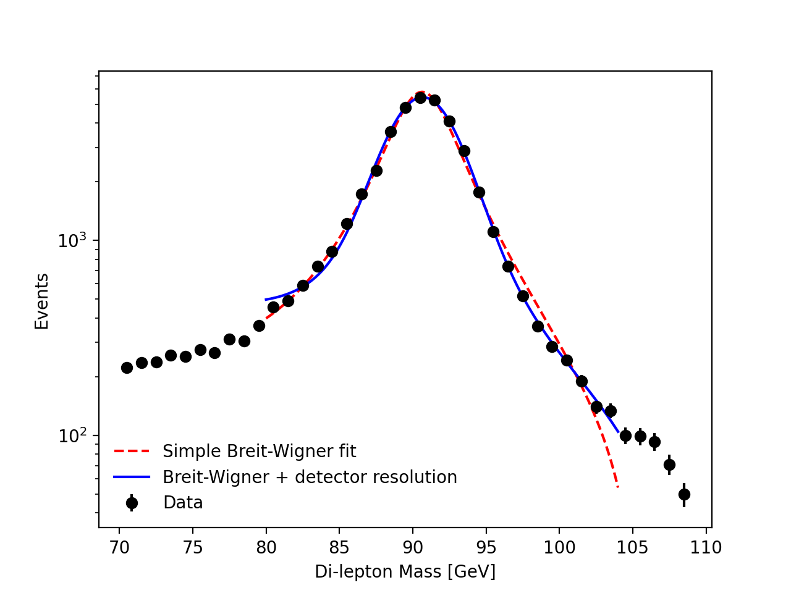

# Finding the Z boson in ATLAS Open Data

I analyzed 2015 ATLAS Open Data to identify the Z boson resonance and estimate its mass from the di-muon invariant mass distribution.

## What came from ATLAS and what I did

The ATLAS Open Data tutorial, [Find the Z boson yourself!](https://opendata.atlas.cern), provided the dataset, the Python notebook, and the instructions for reconstructing the di-muon invariant mass. I extended the analysis by fitting the resonance with a Breit-Wigner model, testing different fit ranges, and adding detector resolution to examine how it affects the measured peak.

## Results

My best fit gives a Z boson mass of 90.70 ± 0.02 GeV, about 0.49 GeV (0.54%) below the accepted value of 91.19 GeV. The resolution fit also gives a detector resolution of 1.80 ± 0.02 GeV. This describes the smearing of the measured mass distribution, and it assumes the Z natural width is fixed at its accepted value of 2.50 GeV. Adding resolution improved the fit from χ²/ndf = 11.9 to 3.7, but the value is still well above 1, so the model remains incomplete. The quoted uncertainties are statistical only. Varying the fit range in the simpler fit moved the mass by about 0.1 GeV, and systematic effects such as calibration are not included.

## Limitations

- I analyzed only one of the 16 available data files (2015, period D), so the results do not represent the full dataset.
- I did not apply detector calibration or efficiency corrections, and I did not compare with simulation.
- The simplified background and single Gaussian resolution model cannot provide a precision mass measurement or an independent measurement of the natural width.

## How I made this

I used Google Colab, Python, NumPy, SciPy, and Matplotlib, with help from an AI assistant for coding guidance, troubleshooting, and checking my interpretation.

## Credit and data

- ATLAS Open Data tutorial: *Find the Z boson yourself!*, https://opendata.atlas.cern
- Data release: `2025e-13tev-beta`
- The original data and tutorial materials were provided by the ATLAS Collaboration at CERN.

The analysis notebook is [z_boson_analysis.ipynb](z_boson_analysis.ipynb).
